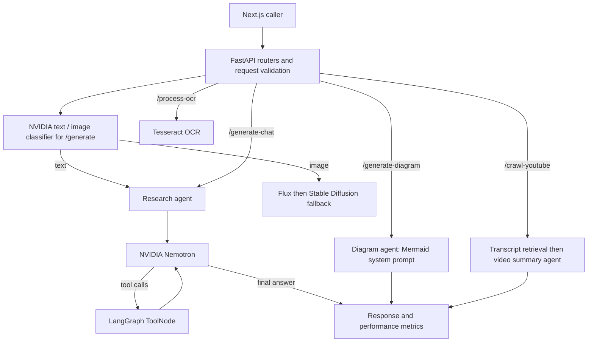

# SophiaNet AI Microservice

SophiaNet is an educational assistant for chat, document retrieval, image generation,
OCR, YouTube lecture summaries and Mermaid diagrams. NVIDIA's hosted Nemotron model
handles every active language-model task. The Llama implementation and its settings
remain in the repository for reference and are never imported by the running app.

## Project structure

The parent workspace contains the web application, microservice and a Compose file:

```text
Project_014_SophiaNet/
├── docker-compose.yml          # Existing published image references
├── microservice/               # FastAPI / Python, this repository
└── web/                        # Next.js 15 / React 19 / TypeScript
    ├── prisma/                 # PostgreSQL schema and migrations
    └── src/
        ├── app/api/            # NextAuth, conversations, chats, tool-chat, downloads
        ├── app/chatbot/        # Chat and tool pages
        ├── app/(app)/          # Landing and sign-in pages
        ├── components/         # Chat UI, tool UIs, landing sections and UI primitives
        ├── hooks/              # File selection, speech recognition and speech output
        ├── providers/          # Authentication, context and toast state
        ├── lib/                # Prisma, validation, microservice URL and Markdown
        └── data/, tools/, types/
```

The web server authenticates users, checks conversation ownership, persists messages
and metrics with Prisma, and forwards JSON or multipart requests to this service.
The diagrams component also calls `/generate-diagram` directly. The web code stores
model names as strings and already reads `response`, `image_url` and
`performance_metrics`, so switching the returned text model to `nvidia` requires no
web change or database migration. Existing historical Llama message records remain.

```text
microservice/
├── app.py                      # App composition, CORS and safe error responses
├── api/
│   ├── requests.py             # Shared JSON/multipart validation and history conversion
│   ├── responses.py            # Shared text response contract
│   └── routes/
│       ├── health.py           # Root and liveness
│       ├── generation.py       # Automatic routing, chat and images
│       └── tools.py            # OCR, YouTube and Mermaid endpoints
├── agents/graph.py             # Compiled LangGraph agent/tool execution loop
├── models/
│   ├── nvidia.py               # NVIDIA cloud client factory
│   ├── llama.py                # Retained inactive Groq/Llama implementation
│   ├── flux.py                # Existing Hugging Face image generation
│   └── stable_diffusion.py     # Existing Bedrock image generation
├── services/
│   ├── assistant.py            # Research, diagram and video agents; text metrics
│   ├── router.py               # NVIDIA JSON classification with validated decisions
│   ├── images.py               # Lazy image-provider construction and fallback
│   ├── rag.py                  # Request-local FAISS index, shared lazy embeddings
│   ├── clip.py                 # Existing image scoring
│   └── image_captioning.py     # Existing BLIP processing pipeline
├── tools/
│   ├── generic_tools.py        # Wikipedia, arXiv and DuckDuckGo factories
│   └── custom_tools.py         # Website retrieval and YouTube transcript tools
├── config/                     # Models, system prompts, files, cloud and tool metadata
├── utils/                      # Files, OCR, transcripts, S3, metrics, logs and exceptions
└── tests/                      # Offline unit/API regression tests
```

## Runtime architecture



The research graph uses `MessagesState`, an `agent` node, a conditional edge to
`ToolNode`, and a return edge to the agent. Tool results are fed back to Nemotron
until it returns a final answer. Tool errors become error messages the agent can
handle; a 16-step graph recursion limit bounds repeated tool calls. Diagram and
YouTube summary agents reuse the graph builder with specialist system prompts and
no search tools, so their output stays focused on the supplied code or transcript.

There is no process-global chat history or persistent graph checkpoint. Callers
supply conversation history on each request. Attached-file indexes belong to one
request; only the embedding model is cached. Text requests without attachments
avoid local ML initialization. BLIP loads only when an image attachment needs a
caption. Image-provider modules and CLIP load only on image-generation requests.

The active tools are Wikipedia, arXiv, DuckDuckGo, `scrape_website` and
`youtube_transcript`. Website retrieval accepts public HTTP(S) addresses, validates
redirect targets, uses a timeout, limits downloads to 1 MB, removes common page
noise and returns at most 12,000 characters with the source URL. Transcript tool
output is capped at 60,000 characters with an explicit truncation marker. The
separate `/crawl-youtube` endpoint passes its transcript to the video agent.

## Configuration and local run

Use the project's Conda environment:

```bash
conda activate sophianet-venv
cd microservice  # when starting from the parent workspace
python -m pip install -r requirements.txt
cp .env.example .env  # only for a new setup; preserve an existing .env
# Set NVIDIA_API_KEY and any image-provider credentials in .env.
python -m uvicorn app:app --host 0.0.0.0 --port 8000
```

`NVIDIA_API_KEY` is required for language-model requests. The default
`NVIDIA_MODEL` is `nvidia/nemotron-3.5-lightning-30b-a3b` using
`https://integrate.api.nvidia.com/v1`. The already installed `langchain-openai`
client uses NVIDIA's OpenAI-compatible Chat Completions API; it does not call
OpenAI or Groq. LangGraph and the remaining integration libraries are already
pinned in `requirements.txt`, so this refactor adds no dependency.

Sampling, timeouts, output limits, chunk sizes and the graph recursion limit live
in `config/models.py`; the NVIDIA and specialist instructions live in
`config/prompts.py`. Override `NVIDIA_MODEL` only with an NVIDIA-hosted chat model
that supports tool calling and JSON output, then rerun the live checks below.
The earlier `nvidia/nemotron-3-nano-30b-a3b` identifier returned HTTP 410 during
verification: NVIDIA reports it retired on September 1, 2026.

`LLAMA`, `LLAMA_ROUTER_MODEL`, `LLAMA_SYSTEM_PROMPT`, the legacy Hub prompt setting,
Groq dependencies and `models/llama.py` are retained but inactive. No active model
falls back to Llama. `HF_TOKEN` remains relevant for Flux. The bundled public
embedding model downloads anonymously and runs on CPU, avoiding expired-token
failures and a dependency on local CUDA hardware.
AWS credentials and the bucket settings in `config/cloud.py` are needed for the
existing image-generation/upload paths. OCR requires the Tesseract system binary.

## HTTP contract

| Method | Path | Behavior |
| --- | --- | --- |
| GET | `/` | Welcome message |
| GET | `/health` | Process liveness, without initializing models |
| POST | `/generate` | NVIDIA classifies text/image; dispatches to research or images |
| POST | `/generate-chat` | NVIDIA research agent with history and optional files |
| POST | `/generate-image` | Existing image generation and fallback |
| POST | `/process-ocr` | Extract text from uploaded images |
| POST | `/crawl-youtube` | Retrieve a URL's transcript and summarize with NVIDIA |
| POST | `/generate-diagram` | Create/refine Mermaid with NVIDIA; optional `code` |

Success responses keep `status`, `model`, `response`, `image_url` when applicable,
and `performance_metrics`. Text generation reports `model: "nvidia"`; image and
OCR model labels keep their existing values. Input errors return HTTP 400 with a
`message`; upstream failures return HTTP 502 with a generic message and details in
server logs.

Example JSON:

```json
{
  "prompt": "Explain this topic",
  "session_history": [
    {"role": "user", "content": "Earlier question"},
    {"role": "assistant", "content": "Earlier answer"}
  ],
  "files": []
}
```

Multipart requests use `prompt`, a JSON-encoded `session_history`, repeated `files`
parts and optional `code`. The shared parser accepts up to ten files, 10 MB each,
200 history messages, and 100,000 characters per prompt/history entry/code field.
Supported attachments are PDF, TXT, MD, PNG, JPG and JPEG. JSON files use
`{"filename": "notes.txt", "content": "aGVsbG8="}` with base64 content; raw UTF-8
strings are also accepted for TXT/MD when they are not valid base64. Only user and
assistant history roles are accepted; clients cannot inject system instructions.

## Verification

```bash
conda run -n sophianet-venv python -m unittest discover -s tests -v
conda run -n sophianet-venv python -m compileall -q app.py api agents config models services tools utils
conda run -n sophianet-venv python -m pip check
```

Tests use fake models/embeddings and mocked external services. They cover the
actual compiled graph, tool results and failures, bounded loops, isolated message
state, concurrent attachment isolation, request validation, JSON/multipart file
handling, endpoint contracts, specialist selection, NVIDIA configuration, router
validation, image fallback and website URL restrictions.

All 22 offline tests passed in `sophianet-venv`. Live checks also passed against
NVIDIA for inference, text/image classification, a real tool-call/result/final-answer
loop, chat, Mermaid generation, a real YouTube transcript summary and retrieval from
a real uploaded TXT file. Direct
live Wikipedia, arXiv, DuckDuckGo and website retrieval checks passed. These are
integration receipts, not a deployment or model-quality benchmark. BLEU and ROUGE
compare responses to prompts/context as inherited diagnostics; there is no curated
reference-answer set, so those scores do not establish answer correctness. Live
image generation/S3 upload and OCR were not exercised; their route contracts and
image fallback were checked with fakes. The configured HF token returned HTTP 401
on a Hub metadata check; verify/refresh that credential before testing Flux. No
web build or Docker build was run.

## Boundaries

The image-filter web page is an existing placeholder and `/image-filter` remains
unimplemented. This refactor does not add that separate feature. No web migrations or
message rewrites are required by the change.

External search, Wikipedia, arXiv, YouTube and model services can fail independently.
There is no new retry policy for the existing third-party tools. The website tool's
DNS check cannot prevent DNS rebinding; enforce outbound network restrictions before
exposing autonomous browsing to untrusted users. Request size/authentication/rate
limits should also be enforced by the deployment gateway; liveness does not verify
provider credentials. Existing CORS and image-generation behavior remain in place.
