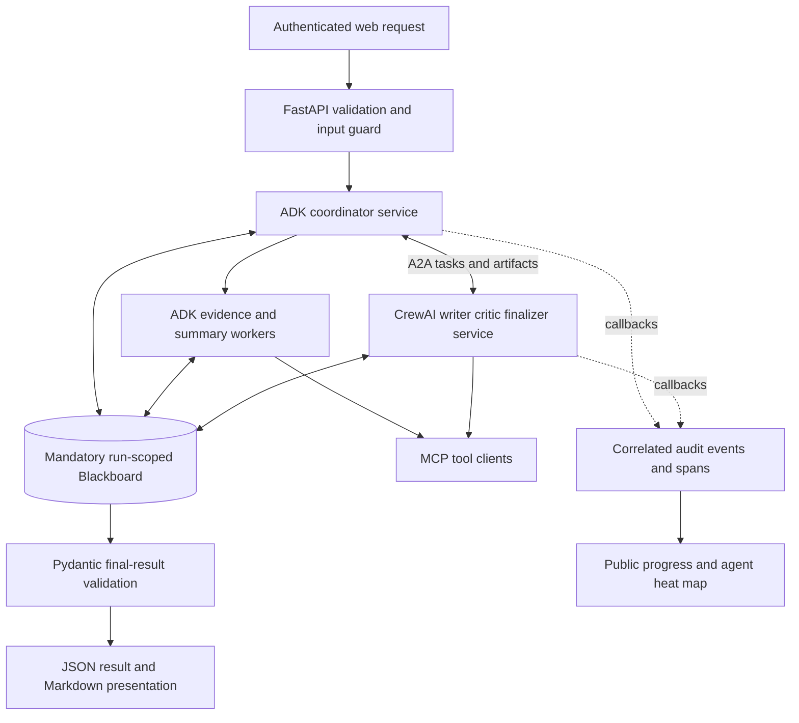
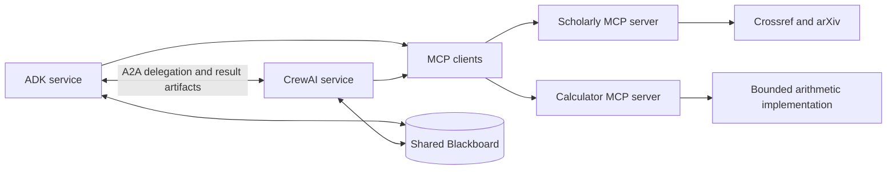
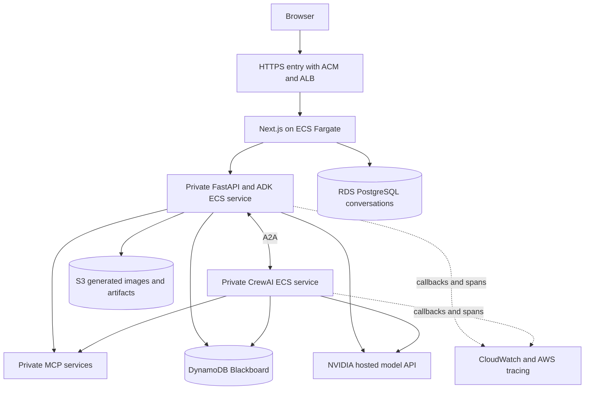

# SophiaNet AI Microservice

SophiaNet helps students, researchers and educators turn documents, lecture videos and scholarly sources into evidence-linked answers, study material, scripts and diagrams. This repository contains the FastAPI backend; the separate `web` repository provides the Next.js application.

**Deployment destination: AWS.** The AWS design below is a deployment plan, not evidence of an existing cloud deployment. This README maps the application to the supplied multi-agent system (MAS) assessment requirements.

**Framework compliance is incomplete:** CrewAI and Google ADK are implemented, but LangGraph still orchestrates several active workflows. The required final implementation must use **CrewAI and ADK as its only agentic frameworks**. The migration, MCP, cross-framework A2A, distributed Blackboard, callback observability and controlled experiments described below remain work to complete. Installing protocol or tracing dependencies does not establish those integrations.

[Documentation index](docs/README.md) · [Detailed literature review](docs/literature_review.md) · [Ten research papers](docs/research/README.md) · [Commands and safety](docs/chat_commands_and_safety.md)

## Objectives and problem statement

Learners must reconcile scattered notes, videos and research papers, check conflicting claims, and produce useful study artifacts. A single generated answer can conceal missing evidence, retrieval errors or unsupported conclusions.

- **PS1 — Fragmented evidence:** collect and retain attributable information across supported sources.
- **PS2 — Unchecked generation:** separate evidence collection, drafting, criticism and final validation.
- **PS3 — Limited transparency:** make public intermediate contributions, tool activity, errors and evidence provenance inspectable.
- **PS4 — Unproven quality and operating cost:** compare orchestration and messaging choices using the same labeled cases before claiming an improvement.

Specialized agents are relevant when one agent's evidence or draft becomes another agent's input. The intended contribution is an inspectable, interoperable educational workflow; improved accuracy, learning outcomes or cost are hypotheses to test.

## Implemented capabilities and code structure

| Capability | Current implementation |
| --- | --- |
| Chat and uploaded-document questions | NVIDIA Nemotron, request-local FAISS retrieval and model/tool loops |
| Agent battleground | Advocate → Critic → Judge; earlier contributions enter later agents' context; NDJSON streaming |
| Research Paper Studio | Model-planned Crossref/arXiv retrieval and validated candidate selection; source links preserved |
| Learning Studio | Pydantic-validated quizzes and flashcards; CrewAI narration/code scripts |
| Summarization | Google ADK `LlmAgent`, `Runner` and isolated in-memory session using NVIDIA |
| Notes, videos and diagrams | Tesseract OCR, YouTube transcript summaries and Mermaid generation |
| Generated images | SD-Turbo by default; retained Flux/Bedrock providers; generated output uploaded from memory to S3 |
| Prompt safety | NVIDIA classifier with Pydantic verdict validation; blocked input 403, unavailable screening 503 |

The configured default language model is NVIDIA-hosted `nvidia/nemotron-3.5-lightning-30b-a3b`; availability must be checked at deployment. MiniLM embeddings support attachment retrieval, BLIP captions image attachments, and CLIP supplies image/text diagnostics. Llama source/configuration remains inactive. Local CPU workloads include embeddings and default image inference; model-weight caches are distinct from generated images. Images must not fall back to local files or inline data when S3 fails. Live S3 delivery still needs valid AWS credentials and qualification.

```text
microservice/
├── app.py                 # Router composition, guard dependency, exception handlers
├── api/                   # JSON/multipart request models, responses and task routes
├── agents/                # Current LangGraph tool loops and debate state
├── services/
│   ├── adk_summary.py     # Actual Google ADK summarization
│   ├── scripts.py         # Actual sequential CrewAI writer/editor
│   ├── commands.py        # Validated slash-command dispatch
│   ├── guardrails.py      # Model-based input screening
│   ├── paper_research.py  # Current research orchestration
│   ├── study.py           # Pydantic quiz/flashcard outputs
│   └── assistant.py, rag.py, images.py
├── models/                # NVIDIA and image-provider clients; inactive Llama
├── tools/                 # Search, scholarly lookup, calculator and retrieval tools
├── config/, utils/        # Prompts, configuration, OCR, S3, metrics and logging
├── scripts/, tests/       # Conda launchers, checks and regression tests
└── docs/research/         # Ten papers, catalogue and provenance notes
```

## Literature review and agent requirements

This is one summary table for the presentation's literature-review slide. The linked corpus contains ten papers and version/provenance records. Product descriptions indicate overlap, not proven missing features in competitors; gaps below are requirements for SophiaNet and its evaluation.

| Literature or existing service | Relevant finding/capability | Gap or question for SophiaNet | Requirement |
| --- | --- | --- | --- |
| [RAG](https://arxiv.org/abs/2005.11401), [Sentence-BERT](https://aclanthology.org/D19-1410/) | Retrieval and reusable semantic representations support evidence access | **G1:** measure source coverage and answer support on course material | R1, R2 |
| [ReAct](https://arxiv.org/abs/2210.03629), [Self-RAG](https://arxiv.org/abs/2310.11511) | Actions, observations and critique motivate evidence-aware workflows | **G2:** test whether specialist critique improves supported answers over a simpler workflow | R2, R3 |
| [Tutor CoPilot](https://arxiv.org/abs/2410.03017) | Educational interventions require outcome-based evaluation | **G3:** functional demos do not establish learning benefit | R6 |
| [CLIP](https://proceedings.mlr.press/v139/radford21a.html), [BLIP](https://proceedings.mlr.press/v162/li22n.html) | Image/text alignment and captioning enable pretrained media pipelines | **G4:** captions and alignment scores can miss educational detail | R2, R6 |
| [Latent diffusion](https://arxiv.org/abs/2112.10752), [Tesseract](https://research.google/pubs/an-overview-of-the-tesseract-ocr-engine/) | Image synthesis and OCR provide media-processing foundations | **G5:** measure OCR fidelity and generated-artifact usefulness independently | R2, R6 |
| [Nemotron 3 Nano](https://arxiv.org/abs/2512.20848) | A model-family research foundation | **G6:** paper benchmarks do not qualify the currently configured hosted Lightning model | R6 |
| [NotebookLM / Google's source-grounded learning overview](https://services.google.com/fh/files/misc/notebooklm_gfe_one_pager.pdf) | Source-grounded assistance and citations already exist | **G7:** distinguish SophiaNet through measured, inspectable orchestration rather than feature-count claims | R3, R5, R6 |
| [Elicit](https://support.elicit.com/en/articles/14757543-getting-started-with-elicit-which-workflow-should-i-use) | Research and systematic-review workflows already exist | **G8:** evaluate relevance, provenance and transparency against an appropriate research workflow | R1, R5, R6 |

| Requirement | Origin | Agent or system responsibility | Acceptance evidence |
| --- | --- | --- | --- |
| **R1** — Attributable source discovery | PS1, G1, G8 | ADK evidence worker using scholarly/search tools | Relevant source IDs/URLs and retrieval fixtures |
| **R2** — Grounded artifacts and validation | PS2, G1–G5 | CrewAI writer, critic and finalizer; deterministic validators | Evidence-to-claim checks and valid final schema |
| **R3** — Explicit context handoffs | PS2–PS3, G2, G7 | ADK coordinator and all participating workers | Blackboard versions proving intermediate output was consumed |
| **R4** — Safe execution | PS2–PS3 | Input/tool/output checks and framework callbacks | Safe/unsafe prompt and malformed-tool fixtures |
| **R5** — Interoperability and auditability | PS3, G7–G8 | ADK and CrewAI A2A services; tracing callbacks | Cross-service task, artifact and parent-trace linkage |
| **R6** — Reproducible quality/cost evaluation | PS4, G3–G8 | Evaluation harness and human/reference review | Dataset, raw runs, latency/cost distributions and failure analysis |

## Assessment requirement coverage

| # | Required capability | Current evidence and remaining work |
| --- | --- | --- |
| 1 | Mandatory Blackboard; compare messaging | Debate/research have request-local shared state. **Partial:** build an explicit cross-service Blackboard with provenance/versioning; compare P2P |
| 2 | At least two tools through MCP | Search, scholarly lookup, calculator and parsers exist as direct integrations. **Pending:** expose/invoke at least two through actual MCP |
| 3 | Pydantic structured final output | Quiz/deck, research selection and guard verdicts are validated. **Partial:** enforce a common final-result schema on every agent workflow |
| 4 | Sequential, hierarchical and parallel patterns | Sequential CrewAI and graph workflows exist. **Pending:** compliant ADK/CrewAI variants and controlled comparison |
| 5 | Callback monitoring and agent heat map | Public debate events, timers and error logs exist. **Pending:** common callbacks, per-agent timings/tool errors and heat-map data |
| 6 | A2A across frameworks | **Pending:** ADK and CrewAI currently execute in one application without A2A exchange; zero implemented cross-service A2A participants |
| 7 | CrewAI and ADK only | Both are used. **Not compliant yet:** replace active LangGraph orchestration and remove other agent-framework paths |
| 8 | Guardrails and validation callbacks | Input filter, request schemas and URL restrictions exist. **Partial:** callback validation of tool returns, retrieved content and final artifacts |
| 9 | Tracing and provenance | Source metadata and basic logs exist. **Pending:** correlated, durable end-to-end spans and audit events |
| 10 | Around 40+ runs, personas, cost/time and boxplots | Functional checks exist. **Pending:** the controlled dataset and experiment below; no benchmark distributions yet |
| 11 | Cloud deployment | **Planned on AWS:** no deployed endpoint, infrastructure acceptance record or measured AWS cost is asserted |

## MAS architecture: current and target

Current handoffs are concrete: `DebateState` stores Advocate/Critic outputs consumed by subsequent roles; research state passes the search plan and retrieved candidates into selection; CrewAI's editor consumes the writer's draft through task context. ADK summary sessions are isolated. These are useful shared-context primitives, but not yet a distributed Blackboard or A2A protocol implementation.

**Target architecture — proposed, not implemented:** an ADK coordinator supervises evidence workers; independent evidence tasks may run in parallel, followed by sequential CrewAI drafting/criticism/finalization. Native ADK/CrewAI orchestration replaces graph agent nodes. ReAct is a prompting/action pattern to compare within these frameworks, not permission to introduce another agentic framework. Prefer a direct NVIDIA client in the final adapters to make framework boundaries unambiguous.



### Blackboard and messaging comparison

The proposed AWS Blackboard uses DynamoDB for tenant/run-scoped state and versions, with large artifacts referenced in S3. A state record must capture `run_id`, tenant/owner, task/agent ID, version, status, evidence references, public contributions, parent event, timestamps and validation outcomes. Conditional writes prevent lost updates; agents read committed versions, preserve provenance, and never treat another agent's text as trusted instructions. Define retention/expiry and reject cross-tenant reads. PostgreSQL conversation history and browser session storage are separate concerns, not substitutes for this Blackboard.

**Example required handoff:** evidence worker writes source records → writer reads that version and writes a draft → critic reads sources and draft and writes review findings → finalizer reads the findings and publishes a validated answer. Record consumed version IDs so sharing can be demonstrated, not inferred.

The Blackboard is mandatory in the delivered system. A P2P baseline may pass task artifacts directly between agents in an isolated experiment; it does not replace the required deployment architecture. Hold model, tools, prompt cases and budgets constant when comparing latency, message/token volume, stale-state errors and answer support.

| Pattern to evaluate | Design rationale | Cost or failure question |
| --- | --- | --- |
| Sequential | Clear evidence → draft → review dependencies | Does critical-path latency outweigh quality gains? |
| Parallel with join | Independent source retrieval or independent critiques | Does the join merge conflicting evidence correctly? |
| Hierarchical | ADK coordinator allocates work and requests correction | Do manager overhead and extra calls justify adaptive routing? |

The hybrid target is a design hypothesis: parallelize independent work and preserve sequential review dependencies. No architecture is declared empirically “best” before measurement.

### MCP and cross-framework A2A



The two required MCP tools are proposed as `search_papers(query, since, limit)` and `calculate(expression)`, reusing existing implementations. MCP acceptance requires real discovery and tool calls, typed success/error results, timeouts, malformed-result rejection and a trace linking the call to the consuming agent. A library tool invocation alone is not MCP.

A2A acceptance requires **two independently addressable services**, one ADK and one CrewAI, with discoverable agent capabilities, authenticated task exchange, status/failure handling and structured artifacts. Record task/context IDs and link them to Blackboard run/version IDs. A2A carries delegation/results; the Blackboard holds shared context; MCP connects tools. Ordinary internal function calls or application HTTP routes do not establish A2A. Pin and test mutually compatible protocol/SDK versions during implementation. See the [A2A specification](https://a2a-protocol.org/latest/), [ADK A2A guide](https://google.github.io/adk-docs/a2a/intro/), [MCP documentation](https://modelcontextprotocol.io/docs/getting-started/intro) and [CrewAI processes](https://docs.crewai.com/en/concepts/processes).

## Structured outputs, security and observability

The proposed common Pydantic final result contains `run_id`, `status`, `answer_markdown`, typed evidence/citations, artifact references, warnings and metrics. Validate before publishing; Markdown/table views derive from validated fields. This schema is a target, not an existing API contract. Current routes retain their task-specific JSON fields and Markdown text.

Current protection includes Pydantic request/decision validation, supported file limits, public-URL restrictions, bounded tool loops and the NVIDIA prompt classifier. Safety decisions fail closed: 403 blocked, 503 unavailable, 413 oversized screening input. Health/OCR-only extraction bypass model screening. The filter does not inspect binary/extracted attachments, retrieved content or generated output and is not a guarantee against prompt injection.

Required callback points are before/after each agent, model and tool invocation, plus error/cancellation/finalization. Validate tool return types and sizes before context publication; screen source content and outgoing artifacts; preserve cancellation and retry limits. Test neutral, terse, novice, expert and adversarial personas, including abusive phrasing and embedded override attempts. Use synthetic secrets and harmless attack fixtures. Record public contributions and decision codes, never hidden reasoning, tokens, credentials or unrestricted document contents.

Proposed audit events carry run/task/trace/parent IDs, agent/framework, prompt-template version, input/output hashes or protected artifact references, model/version, tool/source provenance, timing, token usage when reported, validation status and safe error codes. Configure OpenTelemetry spans exported to AWS tracing and CloudWatch structured logs, with access controls and retention. Current file logging, NDJSON events and installed telemetry packages are not this completed observability pipeline; CrewAI tracing is currently disabled.

A proposed agent heat map places agents on rows and execution phases/time buckets on columns. Color by duration or error count and provide a separate failure indicator and accessible numeric table. Derive it from callback spans; do not display invented utilization, model attention or private reasoning.

## Experimental design and results boundary

**Dataset and benchmark are planned; no 40-run evaluation has been performed.** Build 40 labeled cases from **5 personas × 2 prompt structures × 4 task families**. Personas: novice learner, advanced learner, educator, time-constrained researcher, adversarial user. Prompt structures: direct task brief and ReAct-style action/observation instructions. Task families: grounded document answer, scholarly research, educational script and structured study artifact. Adversarial cases use matched benign tasks with synthetic injection/abusive-content variants and explicit expected allow/block outcomes.

Run the same 40 cases against **3 orchestration variants × 2 messaging variants = 240 end-to-end runs** (40 per configuration). All variants use only ADK/CrewAI. The production candidate always uses Blackboard; P2P is an experimental control. Freeze source snapshots, model/configuration, prompts, evidence, validation rules and agent/tool budgets. Randomize execution order, tag cold/warm starts, record concurrency and report failures in the denominator. Replicate a subset to separate model variability from case-to-case variation.

Dataset records should contain case/persona/task IDs, exact prompt and template version, source hashes/URLs, reference answer or rubric, expected citations, schema and safety outcome. Raw run records add architecture/messaging, completion/error status, public intermediate artifacts, per-agent and end-to-end duration, time to first visible event, tool calls, token usage, retries and cost inputs. Keep the dataset, raw runs, plotting code and pricing snapshot with the evaluation artifacts when implemented; they do not exist as a completed benchmark today.

Evaluate reference-supported correctness, citation precision/coverage, schema validity, safe blocking/false blocking and tool success. A separately configured LLM judge may supplement reference/human scoring; disclose its model/prompt, calibrate it on a human-reviewed subset and report disagreements. Existing prompt-versus-answer BLEU/ROUGE and transformed CLIP scores are diagnostics, not correctness or learning-outcome evidence.

Report p50/p95 runtime, per-agent critical-path contributions, success/failure rate, cost per attempted/successful run and paired quality differences. Produce boxplots of end-to-end latency and per-run cost by architecture/messaging, plus per-agent duration and error heat maps. Include sample counts, failed/censored runs and cold/warm distinctions. Do not generate a boxplot from invented values or treat 54 unit tests as 54 experimental runs.

Estimate cost before running, then reconcile against usage and AWS billing:

```text
model cost = sum(input_tokens * input_rate + output_tokens * output_rate)
run cost = model cost + tool fees + compute allocation + storage/request/network allocation
study cost = sum(attempted run costs) + shared infrastructure allocation
```

Use dated rates and the selected AWS region; include guard, routing, manager, retries, ALB/NAT/database/tracing overhead and idle time. Missing provider usage/rates means unknown or estimated cost, not zero. No numeric AWS cost, latency advantage or quality improvement is currently claimed.

Previous local verification recorded 54 backend tests and successful live command/debate and guard checks; see [verification details](docs/chat_commands_and_safety.md). These are historical functional receipts, not this controlled experiment or AWS acceptance. Re-run checks against the final compliant implementation.

## AWS deployment design — planned



Use ECR for deployment images; ECS Fargate for the web and CPU API/agent/tool services; private subnets/security groups for internal services; RDS PostgreSQL for Prisma persistence; DynamoDB for versioned Blackboard state; S3 for generated images/artifacts; Secrets Manager for model/OAuth/database secrets; least-privilege task roles for AWS access. NVIDIA remains an external model provider even though application compute is on AWS. Budget NAT egress or suitable endpoints for private tasks accessing AWS/external services. [AWS documents Fargate networking](https://docs.aws.amazon.com/AmazonECS/latest/developerguide/fargate-task-networking.html), [secret injection](https://docs.aws.amazon.com/AmazonECS/latest/developerguide/secrets-envvar-secrets-manager.html) and [CloudWatch log configuration](https://docs.aws.amazon.com/AmazonECS/latest/developerguide/using_awslogs.html).

Fargate is a CPU target for this design. SD-Turbo/local models need measured memory, startup and runtime budgets; separate heavy inference from interactive requests if needed. GPU workloads require a separate supported compute choice such as ECS on GPU EC2, rather than assuming Fargate GPU support. [AWS Fargate FAQ](https://aws.amazon.com/fargate/faqs/).

Before deployment, implement task/service definitions and infrastructure configuration, service authentication, restricted CORS, secured proxy routes, signed A2A/MCP access, health/readiness checks, stream timeout/cancellation handling, TLS, rate/resource limits, schema migrations, backup/retention and rollback procedures. `/health` is process liveness, not a provider/database readiness test. The existing uploader defaults to public-read ACLs; private S3 plus time-limited authorized access requires code changes before that security claim is valid. [S3 presigned access](https://docs.aws.amazon.com/AmazonS3/latest/userguide/ShareObjectPreSignedURL.html).

AWS acceptance evidence must include the deployed URL, region/service configuration, successful real OAuth login, per-user ownership isolation, streaming debate, two MCP tools, ADK↔CrewAI A2A traces, Blackboard consumption, real S3 upload/read, failure recovery and measured cost/runtime. None is implied by local Compose or existing Dockerfiles.

## Local execution and API

Run from this repository using Conda Python:

```bash
conda run -n sophianet-venv python -m pip install -r requirements.txt
# For a new setup only: copy .env.example to .env and configure credentials.
./scripts/run.sh
# In another terminal:
./scripts/test.sh
conda run -n sophianet-venv python -m pip check
```

The scripts explicitly use `sophianet-venv`. Configure `NVIDIA_API_KEY`, optional `NVIDIA_MODEL`, `PORT` (default 8000), and AWS credentials/bucket settings for current S3 paths. Tesseract must be installed for OCR. Never overwrite an existing `.env` or include credentials in source/docs. The AWS task-role/Secrets Manager configuration above is a deployment target, not a replacement already wired into infrastructure.

| Endpoint | Behavior |
| --- | --- |
| `GET /health` | Liveness without loading models |
| `POST /generate` | Automatic generation or validated command dispatch |
| `POST /generate-chat`, `/generate-image`, `/generate-summary` | Dedicated chat, S3-backed images and ADK summary |
| `POST /generate-debate` | Stream Advocate/Critic/Judge public contributions and final answer |
| `POST /search-papers` | Scholarly retrieval and model relevance selection |
| `POST /generate-script` | CrewAI narration/code script |
| `POST /generate-quiz`, `/generate-flashcards` | Structured study material |
| `POST /process-ocr`, `/crawl-youtube`, `/generate-diagram` | Tool workflows |

Commands are `agent-battleground`, `summarize`, `research`, `quiz`, `flashcards`. Send the identifier separately from the prompt, e.g. `{"command":"summarize","prompt":"Source text"}` to `/generate`; battleground uses `/generate-debate`. Unknown/misrouted commands and command attachments are rejected. JSON/multipart file limits and response contracts are documented in [commands and safety](docs/chat_commands_and_safety.md) and FastAPI `/docs`.

## Presentation and report deliverables

Names, enrollment numbers and individual contributions were not supplied. Populate them from the actual team; the responsibility areas below are proposed assignments, not attribution of completed work.

| Responsibility area | Name / enrollment number | Evidence to supply |
| --- | --- | --- |
| ADK/CrewAI migration and Blackboard | Not supplied | Owned modules, tests and context-handoff demo |
| MCP/A2A interoperability | Not supplied | Two tool receipts and cross-service task traces |
| Frontend and accessibility | Not supplied | UI changes and actual demo captures |
| Guardrails, callbacks and observability | Not supplied | Validation tests and trace/heat-map artifacts |
| Dataset, evaluation and AWS deployment | Not supplied | Raw runs, plots, cost records and deployment evidence |

| Slide | Required content and evidence |
| --- | --- |
| 0 | SophiaNet title; actual team names and enrollment numbers |
| 1 | Objectives and PS1–PS4 |
| 2 | One literature/products table and identified gaps |
| 3 | R1–R6 mapped to problem statements/literature gaps |
| 4 | End-to-end MAS and chosen orchestration; distinguish target from current |
| 5 | Sequential/parallel/hierarchical comparison and measured or clearly labeled heuristic rationale |
| 6 | Agent–MCP diagram and two real tool-call traces |
| 7 | Blackboard versus P2P; A2A flow and actual participating service count |
| 8 | Input/tool/output guardrails, safeguards and callback validation |
| 9 | Dataset, personas, prompt variants, configurations and run counts |
| 10 | Reference/human/LLM-judge validation; system/per-agent time, cost and boxplots |
| 11 | Actual responsibility/self-contribution matrix |
| 12 | Screenshots from real local/AWS runs with environment, case/run ID and date |
| 13 | Supported outcomes, limitations and remaining work |
| 14 | All cited papers, product documentation, protocols and AWS sources |

The report outline is: **1 Introduction (p.1); 2 Problem Statement (pp.2–3); 3 Literature Review (pp.4–6); 4 Methodology (pp.8–16); 5 Technology Stack (p.17); 6 Experimental Results (pp.18–25); 7 Team Responsibility/Self-Contribution Matrix (p.26); 8 Conclusions (p.27)**. Methodology must cover agent derivation, orchestration, Blackboard, MCP/A2A, safeguards and AWS design. Results must contain actual run snapshots, detailed outputs, per-agent/system metrics and failure analysis. Treat these page ranges as the supplied report layout, not documents/results already produced here.

The current stack is Python/FastAPI/Pydantic, CrewAI, ADK, NVIDIA transport, local ML/OCR and S3 libraries, with legacy active LangGraph orchestration awaiting migration. The final agentic stack is CrewAI + ADK only. The companion UI uses Next.js, React, TypeScript, Tailwind, NextAuth, Prisma, Mermaid and Markdown rendering.

The current outcome is a working local educational-tool integration with explicit compliance gaps. A completed submission requires the framework migration, interoperable protocols, traceable Blackboard workflow, reproducible evaluation and AWS deployment evidence. References are linked at their claims and preserved in the [research catalogue](docs/research/papers.json); use those records for the final references slide/report.
