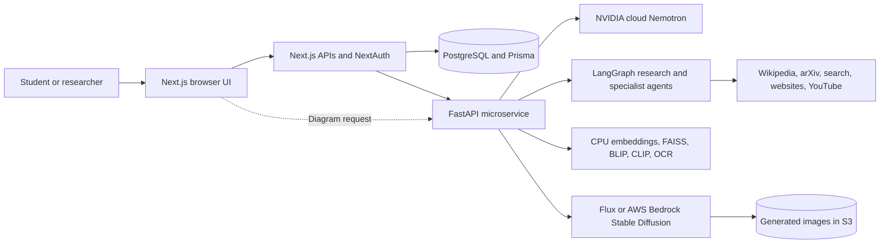

# SophiaNet — Network of Wisdom

SophiaNet is an educational AI workspace that connects questions, documents, images, lecture transcripts and web research. A Next.js application manages sign-in and conversations; a Python microservice combines NVIDIA-hosted language inference, LangGraph agents, document retrieval, image generation, OCR and Mermaid diagrams.

The project is an integration prototype. It does not yet establish improvements in learning outcomes, answer correctness or image quality through a controlled evaluation. The documentation separates working implementation, earlier verification receipts and proposed development.

## What the project does

- Answers questions with NVIDIA Nemotron and optional Wikipedia, arXiv, web-search, website and YouTube tools.
- Retrieves context from uploaded PDF, TXT and Markdown documents, or captions from image attachments.
- Generates images with Flux and falls back to Stable Diffusion through AWS Bedrock.
- Extracts text from images, summarizes YouTube transcripts and creates or refines Mermaid diagrams.
- Stores authenticated users, conversations, model labels and chat messages in PostgreSQL through Prisma.
- Presents Markdown/code, image previews/downloads, diagram pan/zoom and browser speech controls.

Llama source, prompts and configuration are retained for reference. No active language-model path imports or selects Llama.

## Documentation

| Document | Contents |
| --- | --- |
| [Documentation index](docs/README.md) | Reading guide and scope |
| [Project objectives](docs/project_objectives.md) | Problem, users, goals, workflows and contribution boundaries |
| [Features](docs/features.md) | Feature matrix, API paths and implementation status |
| [Models and AI infrastructure](docs/models_and_ai_infrastructure.md) | Every configured model, provider, tool, prompt and processing pipeline |
| [System architecture](docs/system_architecture.md) | Mermaid context, components, sequences, graphs, deployment and data model |
| [Setup and operations](docs/setup_and_operations.md) | Conda/web setup, configuration, storage and operational boundaries |
| [Evaluation and limitations](docs/evaluation_and_limitations.md) | Existing diagnostics, earlier evidence and remaining qualification gaps |
| [Literature review](docs/literature_review.md) | Ten papers, findings, gaps and SophiaNet's relationship to prior work |
| [Research collection](docs/research/README.md) | Paper PDFs, bibliographic details and provenance |

## System at a glance



## Workspace structure

```text
Project_014_SophiaNet/
├── README.md
├── docs/                 # Product, architecture, operations and research
├── docker-compose.yml    # Existing published image deployment description
├── microservice/         # Python/FastAPI microservice
└── web/                  # Next.js/React/Prisma web application
```

## Start locally

Follow [setup and operations](docs/setup_and_operations.md) for prerequisites and configuration. In separate terminals, start the Python service from `microservice/` using `sophianet-venv`, and run `npm run dev` from `web/`. Configure NVIDIA, Google OAuth and PostgreSQL before exercising the authenticated application. Image generation additionally needs its own provider and S3 credentials.

The active default text model is `nvidia/nemotron-3.5-lightning-30b-a3b`; exact settings live in [model configuration](microservice/config/models.py). This is cloud inference through NVIDIA's API, even though the integration uses the OpenAI-compatible client library.

## Evidence and scope

Documentation was grounded in source on **2026-10-30**. The preceding implementation session recorded 22 passing Python tests and live NVIDIA chat, routing, tool-loop, diagram, YouTube and TXT-retrieval checks. These are earlier integration receipts, not a fresh deployment verdict or research benchmark. See the [evidence boundaries](docs/evaluation_and_limitations.md).

The image-filter page is a placeholder, and there is no `/image-filter` microservice route. Text-to-video generation, slide/document export, semantic image retrieval, learner modeling and persistent document indexing are not implemented.
