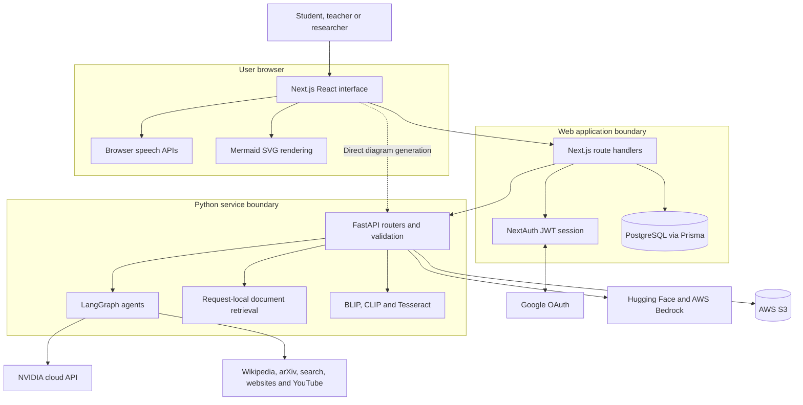
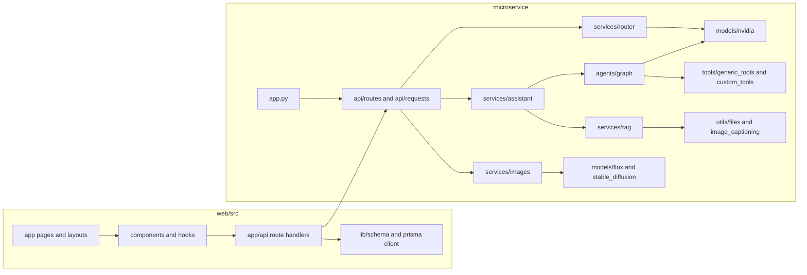
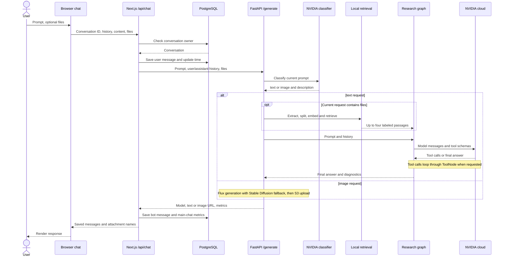
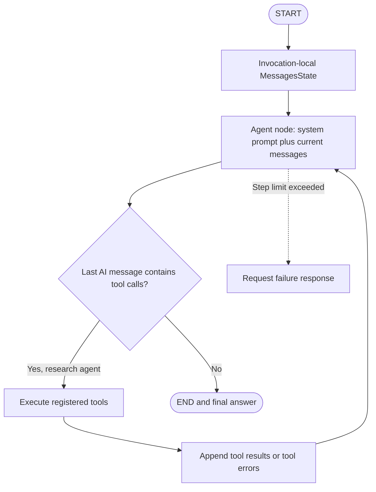
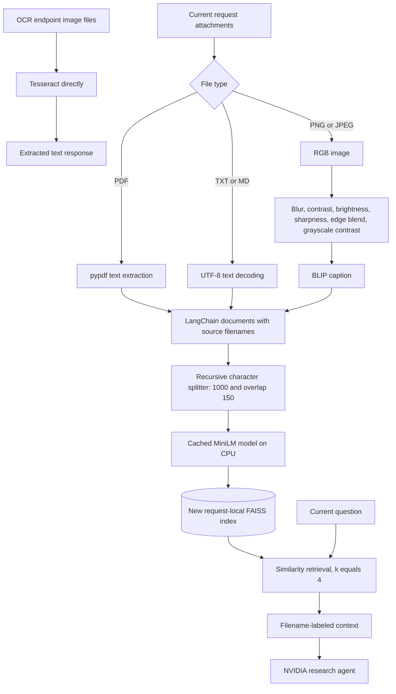
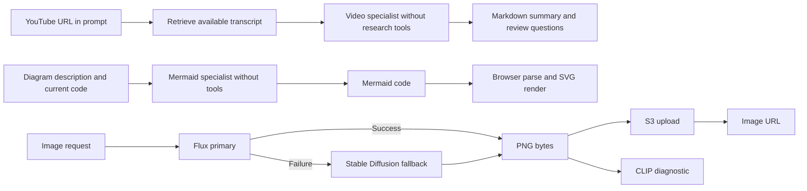
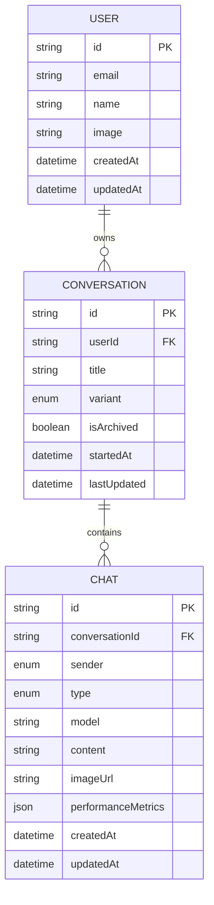
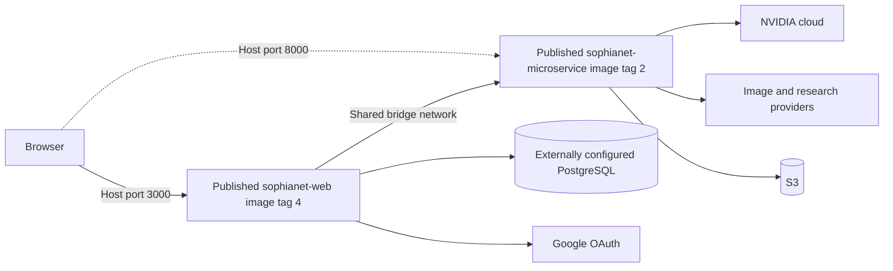

# System architecture

[Documentation index](README.md) · [AI infrastructure](models_and_ai_infrastructure.md) · [Operations](setup_and_operations.md)

These Mermaid diagrams describe the application design. They distinguish the authenticated web application from the Python API, which currently does not enforce an application authentication scheme.

## System context and trust boundaries

Normal chat and tool APIs check a web session and conversation ownership. Direct Python access and the browser's dedicated diagram request do not inherit those checks. The Next.js `/microservice/:path*` rewrite is a forwarding rule, not an authentication guard. Deployment must account for both access paths.

## Source components

`app.py` composes the routers, CORS and exception handlers. The assistant service owns agent selection and text diagnostics; it creates request-local retrieval state. The image service owns provider selection and fallback. Llama remains a separate inactive source file and is not part of the active dependency graph.

## General chat sequence

The classifier is invoked for `/generate`; `/generate-chat` and `/generate-image` bypass that classification step. The user message is saved before upstream generation, so a provider failure can leave an unmatched user message. The web database operations and external generation are not one transaction.

## LangGraph execution

Only the research graph binds tools. The diagram and YouTube graphs run a specialist model node and terminate. There is no persistent graph memory; callers supply history on each request. The 16-step recursion setting bounds graph steps, including both model and tool nodes.

## Attachment retrieval and image processing

The BLIP transformations are heuristics, not learned detection or segmentation. OCR is a separate route. An uploaded scanned PDF is not automatically rasterized into OCR images. The text retrieval index is discarded after the request; only the embedding model is shared. Image generation currently computes inherited retrieval context but does not use it to condition the output.

## Specialist and image workflows

The image providers include their own safer-wording retries; fallback can also occur when the primary cannot initialize. The backend does not parse or validate generated Mermaid. A malformed diagram is detected by browser rendering, which displays an error instead of an automatic repair.

## Data model and persistence

The [Prisma schema](../web/prisma/schema.prisma) defines chat/image types and conversation variants for general chat, notes, YouTube, diagrams and the image-filter placeholder. Foreign keys cascade on user/conversation deletion. There are no separate attachment, document-chunk, vector, tool-trace or learner-profile tables. S3 image objects are not shown as relational entities and are not automatically deleted by a Prisma cascade.

## Existing Compose deployment description

The [Compose file](../docker-compose.yml) references published image tags and injects separate `.env` files. It does not build the local source, define a PostgreSQL service, mount a durable model cache, configure healthchecks, add a job queue or provision provider resources. Consequently, starting those image tags does not establish that the local refactor is running. The Python Dockerfile also does not currently install Tesseract's system executable. No container was built or deployment verified for this documentation task.
