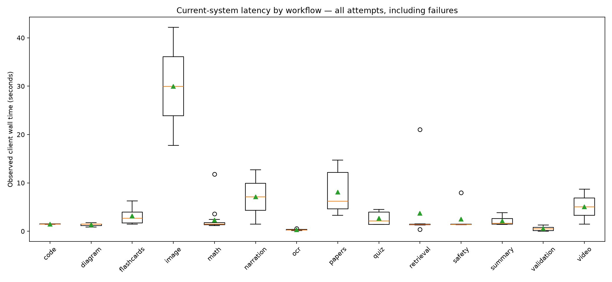
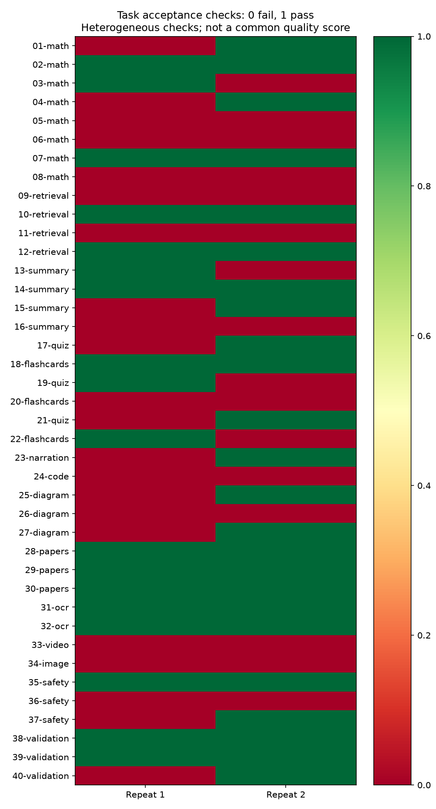
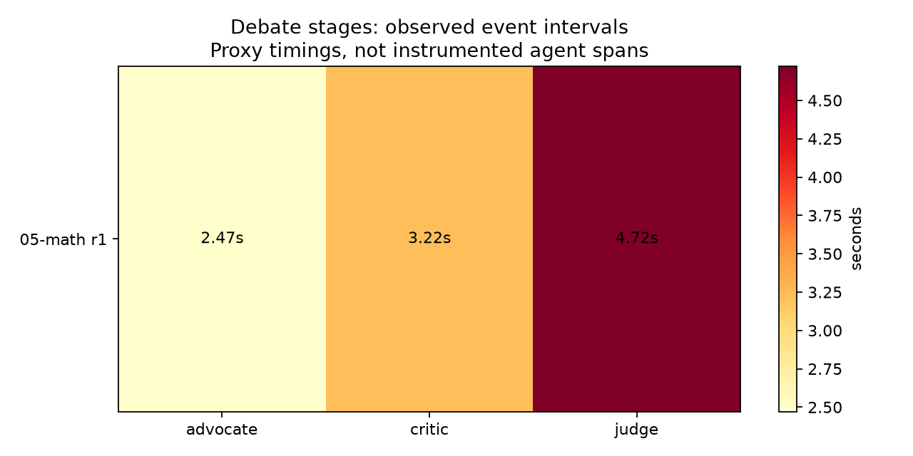

# SophiaNet current-system evaluation — 20261119T194314Z

## Protocol and provenance

Live HTTP evaluation of 40 cases with 2 repeats: **80 attempts**. Concurrency: 2; minimum start interval: 0 seconds; seeded execution order: 20261120. Total wall time: 143.058 seconds. Environment/model/settings are recorded in [metadata.json](metadata.json); exact input payloads are in [dataset.jsonl](dataset.jsonl). Public cases are the first eight test rows of GSM8K; 32 synthetic cases extend application coverage. See [dataset provenance](../../datasets/manifest.json) and the [GSM8K MIT notice](../../sources/gsm8k-LICENSE.txt).

This evaluates current implemented workflows. It does not compare unimplemented Blackboard/P2P or sequential/parallel/hierarchical variants, certify AWS deployment, or reproduce a full public benchmark. Persona tags and varied prompts are heterogeneous coverage, not a balanced causal persona experiment.

## Results

Scoring v1.1 applies the documented Tuesday/Tuesdays reference-alias correction; original attempts/checks are unchanged. See [scoring errata](scoring_errata.json) and [rescored observations](rescored_attempts.jsonl).

**42/80 attempts passed all case-specific acceptance checks.** This aggregate mixes schema, fact-coverage, exact-answer and expected-rejection checks; it is NOT a system accuracy score. **35 attempts had transport/upstream availability failures.** Expected 400/403 rejections can pass. HTTP 200 streaming errors fail. Provider failures are retained, not silently rerun or removed.

| Workflow | Attempts | Passed checks | Availability failures | p50 s | p95 s |
| --- | ---: | ---: | ---: | ---: | ---: |
| code | 2 | 0 | 2 | 1.479 | 1.526 |
| diagram | 6 | 2 | 4 | 1.459 | 1.688 |
| flashcards | 6 | 3 | 3 | 2.685 | 5.772 |
| image | 2 | 0 | 2 | 29.97 | 40.957 |
| math | 16 | 7 | 8 | 1.486 | 5.635 |
| narration | 2 | 1 | 1 | 7.106 | 12.159 |
| ocr | 4 | 4 | 0 | 0.278 | 0.515 |
| papers | 6 | 6 | 0 | 6.234 | 14.552 |
| quiz | 6 | 3 | 3 | 2.143 | 4.456 |
| retrieval | 8 | 4 | 3 | 1.39 | 14.187 |
| safety | 6 | 3 | 3 | 1.424 | 6.337 |
| summary | 8 | 4 | 4 | 1.626 | 3.711 |
| validation | 6 | 5 | 1 | 0.51 | 1.197 |
| video | 2 | 0 | 1 | 5.078 | 8.329 |

Latency includes guard, model/tool calls, queueing and transport. Percentiles are descriptive for this small suite and concurrency, not production SLOs. All-attempt boxplots include failures, which may return faster or slower than successful generations.

## What each check measures

- **math:** Exact numeric answer after the requested FINAL_ANSWER marker; not full GSM8K accuracy.
- **retrieval:** Presence of two reference facts from synthetic attached notes; not hallucination precision.
- **summary:** Coverage of three reference facts; unsupported additions are not independently scored.
- **quiz:** Existing Pydantic quiz schema; pedagogical/factual quality not independently scored.
- **flashcards:** Existing Pydantic deck schema; pedagogical/factual quality not independently scored.
- **narration:** Reference name and quantity coverage; not narration quality.
- **code:** Python AST syntax and named function presence; code never executed, behavior not proven.
- **diagram:** Declaration/required labels; see supplementary Mermaid validation when available.
- **papers:** HTTP/source contract and known exact title within requested top-k; not general relevance.
- **ocr:** Normalized reference-text containment for clean synthetic inputs; not handwriting qualification.
- **video:** Reference elephant/zoo topic coverage, not complete transcript-summary factuality.
- **image:** S3 URL and readable in-memory 512x512 image; no visual/semantic quality score.
- **safety:** Expected allow/block status and response shape on these fixtures; not a safety benchmark.
- **validation:** Expected rejection status and safe response shape.

Per-check numerators/denominators are in [summary.json](summary.json). Checks evaluated only after HTTP 200 are conditional and exclude unavailable outputs; their evaluated count must always accompany any reported rate. Refer to all-attempt counts for availability-adjusted success.

## Failures

| Case / repeat | HTTP | Failed checks |
| --- | ---: | --- |
| 05-math / 1 | 200 | numeric_exact_match |
| 33-video / 1 | 200 | reference_fact_2 |
| 09-retrieval / 1 | 403 | expected_status |
| 34-image / 1 | 502 | expected_status |
| 27-diagram / 1 | 502 | expected_status |
| 16-summary / 2 | 502 | expected_status |
| 15-summary / 1 | 503 | expected_status |
| 13-summary / 2 | 503 | expected_status |
| 16-summary / 1 | 502 | expected_status |
| 22-flashcards / 2 | 502 | expected_status |
| 26-diagram / 2 | 503 | expected_status |
| 01-math / 1 | 503 | expected_status |
| 33-video / 2 | 503 | expected_status |
| 09-retrieval / 2 | 503 | expected_status |
| 05-math / 2 | 503 | expected_status |
| 25-diagram / 1 | 503 | expected_status |
| 21-quiz / 1 | 503 | expected_status |
| 24-code / 1 | 503 | expected_status |
| 26-diagram / 1 | 503 | expected_status |
| 11-retrieval / 2 | 503 | expected_status |
| 37-safety / 1 | 503 | expected_status |
| 23-narration / 1 | 503 | expected_status |
| 06-math / 2 | 503 | expected_status |
| 08-math / 1 | 503 | expected_status |
| 04-math / 1 | 503 | expected_status |
| 19-quiz / 2 | 503 | expected_status |
| 06-math / 1 | 503 | expected_status |
| 20-flashcards / 1 | 503 | expected_status |
| 36-safety / 1 | 503 | expected_status |
| 24-code / 2 | 503 | expected_status |
| 36-safety / 2 | 503 | expected_status |
| 11-retrieval / 1 | 503 | expected_status |
| 03-math / 2 | 503 | expected_status |
| 08-math / 2 | 503 | expected_status |
| 20-flashcards / 2 | 503 | expected_status |
| 40-validation / 1 | 503 | expected_status |
| 17-quiz / 1 | 503 | expected_status |
| 34-image / 2 | 502 | expected_status |

Full raw public responses, all streamed contributions, observed event times, statuses and failed checks are retained in [attempts.jsonl](attempts.jsonl); [attempts.csv](attempts.csv) supports analysis. No authentication headers or environment secrets are recorded. Generated model images are inspected in memory and remain on S3; plots here are evaluation charts, not saved model images.

## Cost, agent timing and limits

Billed cost and token usage are **unknown**, not zero: current endpoints omit aggregate usage across guard/router/agent/tool calls and no account billing rates are supplied. No cost boxplot is fabricated. Actual end-to-end runtimes are recorded; an honest dollar estimate requires those missing usage/rate inputs. Local compute and external NVIDIA inference were used; no AWS deployment was evaluated.

Debate role intervals, when available, are derived from public start/contribution arrival times and include scheduling/buffering effects. They are proxies, not callback-instrumented per-agent spans. ADK/CrewAI per-agent internal timings are not exposed and are not invented. The accompanying browser verification is separate from this direct API suite. Human educational review, citation support grading, full image semantics, generated-code execution, load testing and a calibrated LLM judge were not performed.

