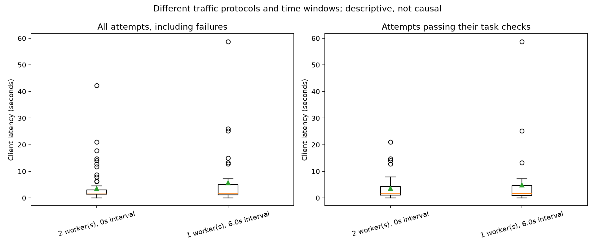

# Current-system evaluation results

The frozen dataset contains 40 cases: eight GSM8K test questions and 32 synthetic workflow fixtures. The two protocols below executed 120 real API attempts in total, with original raw results retained. Results use transparent scoring v1.1 errata for the valid Tuesday/Tuesdays reference variant; original scores and inputs remain available. These are task-specific acceptance checks, not a general accuracy or learning-outcome score.

| Protocol | Attempts | Passed task checks | HTTP 5xx/transport failures | Wall seconds |
| --- | ---: | ---: | ---: | ---: |
| 2 worker(s), 0s interval | 80 | 42 | 35 | 143.058 |
| 1 worker(s), 6.0s interval | 40 | 36 | 2 | 356.406 |

The initial protocol has two repeats per case and two workers. Rate-limit failures are part of its result. The paced protocol runs every case once, with one worker and a minimum six-second start interval. It is a separately labeled run, not replacement retries. Counts must not be pooled into a single accuracy claim. Different time windows, stochastic generation, warm-up and overlapping static browser probes prevent a causal architecture/performance claim.

- [20261119T194314Z — full report](../20261119T194314Z/REPORT.md)
- [20261119T194914Z — full report](../20261119T194914Z/REPORT.md)

Each run stores input snapshots, raw outputs and public debate contributions, status/check results, CSV, JSON, metadata, latency boxplots and heat maps. Cost/token usage are unknown because the endpoints do not expose aggregate billing usage; no zero-cost values or invented cost plots are supplied. The backend/scorer suite passes 62 tests; this test count is separate from live attempts.

## Findings and interpretation

- The initial API server log recorded 29 input-guard `RateLimitError` warnings, consistent with 29 HTTP 503 safety-screening failures. Do not interpret unavailable answers as independently measured factual errors. The guard correctly fails closed.
- Generated-image attempts fail with HTTP 502. The API server log identifies AWS `InvalidAccessKeyId`; image delivery remains blocked until valid S3 access is configured. No generated image was saved locally by the evaluator.
- Public math examples expose wrong numeric answers in some generations. Compare the original reference, final marker and public panel contributions in raw records; an HTTP 200 response or a multi-agent debate does not establish correctness.
- The very short video summary does not include the expected zoo topic. This is a strict topic-coverage failure, not proof that the entire summary is false; this fixture is too small to qualify lecture-summary quality.
- One benign synthetic document request was blocked during the initial protocol. This is a false-blocking example under the suite's stated policy, separate from rate limiting.
- Diagram parser results are supplemental to declaration/label checks. Quiz/flashcard checks establish schema validity, and code checks establish syntax/function presence without execution. Neither proves semantic correctness.
- Browser receipts in the web repository cover a real saved ADK summary, keyboard selection, rejection paths, reload, mobile fit and six tool routes. Duplicate main landmarks were observed. OAuth login, full accessibility and every tool interaction were not qualified.

## Scope and next work

This evaluates the currently implemented system on a small, nonrandom case selection with uncontrolled model training exposure. It does not evaluate a completed CrewAI/ADK-only migration, distributed Blackboard, MCP/A2A, the proposed balanced 240-run architecture study, AWS deployment or educational outcomes. Add independent reference/human review and usage instrumentation before making broader correctness/cost claims. Fix quota handling, S3 credentials and false-blocking cases separately, then record a new versioned run rather than overwriting these observations.
