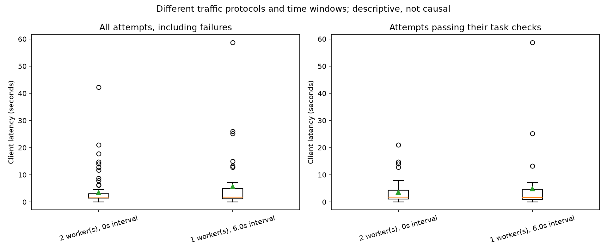
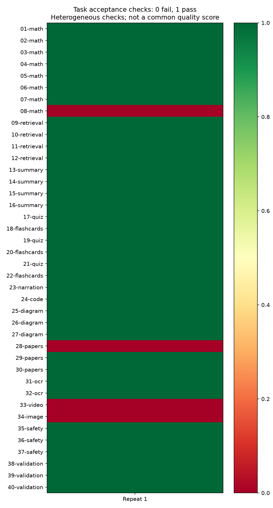

# SophiaNet Microservice — Evaluation Process and Results

This file summarizes the saved evaluation; it does not rerun providers or change application behavior.

## Recorded API results

Evaluation date: **20 November 2026 IST** (run identifiers and timestamps use UTC). **40 cases and 120 live API attempts** were evaluated against real configured providers. The table uses scoring v1.1, including the documented Tuesday/Tuesdays reference correction.

| Protocol | Attempts | Passed task checks | Pass rate | HTTP 5xx/transport failures | Total wall time |
| --- | ---: | ---: | ---: | ---: | ---: |
| 2 worker(s), 0s minimum start interval | 80 | 42 | 52.5% | 35 | 143.058s |
| 1 worker(s), 6s minimum start interval | 40 | 36 | 90.0% | 2 | 356.406s |

These are **heterogeneous task acceptance-check rates, not general accuracy scores**. Expected 400/403 rejections can pass; HTTP 200 with a wrong answer or failed stream does not automatically pass. Failures remain in the denominator. The two protocols differ in repeats, traffic, time windows and warm-up, so their results are descriptive rather than a causal architecture comparison. Do not pool them into a single system-accuracy claim.

## Dataset and scoring process

1. Freeze eight questions from the first eight public GSM8K test rows and 32 synthetic cases before execution. Preserve original questions, source revision, MIT notice, input snapshot and SHA-256 provenance. This is not the full GSM8K benchmark.
2. Exercise math/chat/debate/routing, attached-note retrieval, ADK summaries, quizzes, flashcards, CrewAI narration/code, diagrams, scholarly research, OCR, video summaries, S3 image delivery, guardrails and invalid requests. Persona/format variations provide heterogeneous coverage, not a balanced factorial experiment.
3. Score each workflow using explicit checks: final-marker numeric exact match, reference-fact coverage, Pydantic schema validity, Python AST syntax/function presence, diagram labels/declaration, known paper title within top-k, clean-fixture OCR, video topic coverage, S3 readback or expected rejection status.
4. Run two repeats with two workers for 80 attempts. Then execute every case once with one worker and a minimum six-second start interval for 40 separately recorded attempts. The second protocol does not replace failed observations.
5. Persist raw responses, public streamed contributions, statuses, elapsed times and checks. Produce CSV/JSON summaries, latency boxplots and heat maps. Validate returned diagrams with the frontend Mermaid parser.
6. Preserve original scoring. A missing valid plural alias, Tuesday/Tuesdays, was corrected in a separate rescored view: four observations changed in the first run and one in the paced run. No input, original response or original check was overwritten.

## Findings and interpretation

- The initial run had 29 input-guard rate-limit failures returning 503. The broader HTTP 5xx/transport bucket also includes failures whose causes require separate diagnosis.
- Image delivery failed in both protocols; server diagnostics identified AWS `InvalidAccessKeyId`. No model-generated image was saved locally by the evaluator.
- Wrong numeric answers occurred despite successful HTTP responses. For example, the initial run returned 5 instead of reference 20 for `05-math`; the paced run returned 120 instead of 160 for `08-math`.
- Video output omitted an expected zoo topic. This is a strict coverage failure, not proof that the entire summary was false.
- A benign synthetic document request was blocked in the initial run. The paced run also retained one research HTTP 502 failure.
- All five returned diagrams parsed successfully across both protocols. This does not establish visual or factual quality.
- The backend/scorer suite passed **62 tests**; these are separate from the 120 live attempts.

## Limits

Costs and aggregate token usage are **unknown, not zero**, because the endpoints omit total provider usage and billing rates are unavailable. Debate role timings are observed event intervals, not callback-instrumented internal spans. Schema, fact-coverage and code-syntax checks do not establish educational quality, hallucination precision or executable correctness. No generated code was executed. Public-question training exposure is uncontrolled.

AWS deployment, a completed CrewAI/ADK-only migration, distributed Blackboard/MCP/A2A compliance, architecture comparisons, real Google OAuth login, independent human/LLM-judge scoring and production load qualification were not evaluated. These results describe the current local system only.

## Paced run by workflow

| Workflow | Attempts | Passed checks | p50 client seconds | p95 client seconds |
| --- | ---: | ---: | ---: | ---: |
| code | 1 | 1 | 3.674 | 3.674 |
| diagram | 3 | 3 | 0.860 | 0.902 |
| flashcards | 3 | 3 | 2.525 | 6.043 |
| image | 1 | 0 | 25.972 | 25.972 |
| math | 8 | 7 | 3.200 | 10.415 |
| narration | 1 | 1 | 7.167 | 7.167 |
| ocr | 2 | 2 | 0.193 | 0.236 |
| papers | 3 | 2 | 12.736 | 23.898 |
| quiz | 3 | 3 | 3.931 | 53.258 |
| retrieval | 4 | 4 | 1.315 | 1.415 |
| safety | 3 | 3 | 0.782 | 5.211 |
| summary | 4 | 4 | 1.651 | 2.049 |
| validation | 3 | 3 | 0.428 | 0.433 |
| video | 1 | 0 | 15.022 | 15.022 |

Percentiles are descriptive for these small groups. Wall time includes intentional pacing; per-attempt client latency excludes the wait before its request starts.

## Stored evidence

- [Frozen dataset](evaluation/datasets/system-v1.jsonl), [provenance manifest](evaluation/datasets/manifest.json) and [GSM8K license](evaluation/sources/gsm8k-LICENSE.txt).
- [Protocol comparison and findings](evaluation/results/comparison/README.md), [machine-readable comparison](evaluation/results/comparison/comparison.json).
- [Initial 80-attempt report](evaluation/results/20261119T194314Z/REPORT.md) and [original raw observations](evaluation/results/20261119T194314Z/attempts.jsonl).
- [Paced 40-attempt report](evaluation/results/20261119T194914Z/REPORT.md) and [original raw observations](evaluation/results/20261119T194914Z/attempts.jsonl).
- Each run also contains its input snapshot, metadata, CSV, summary JSON, original/corrected scores, scoring errata, parser receipts and artifact checksums.





## Reproduce from the microservice folder

Use the existing Conda environment and configured provider credentials. Live runs call real providers and may consume quotas or incur charges. Preserve existing result directories; new runs create new timestamped directories.

```bash
conda run -n sophianet-venv python -m pip install -r evaluation/requirements.txt
./scripts/run.sh
```

In another terminal, from the same folder:

```bash
./scripts/test.sh
conda run --no-capture-output -n sophianet-venv python -m evaluation.run --repeats 2 --workers 2
conda run --no-capture-output -n sophianet-venv python -m evaluation.run --repeats 1 --workers 1 --interval 6
```

For each new result directory, apply the documented scoring correction and build its report. Substitute the actual timestamped directories below:

```bash
conda run -n sophianet-venv python -m evaluation.rescore evaluation/results/<run-id>
conda run -n sophianet-venv python -m evaluation.report evaluation/results/<run-id>
conda run -n sophianet-venv python -m evaluation.compare evaluation/results/<initial-run-id> evaluation/results/<paced-run-id>
```

See the [evaluation guide](evaluation/README.md) for scorer scope and source selection. Do not rebuild the frozen dataset to replace unfavorable results. The web repository stores separate browser evidence and actual screenshots.
